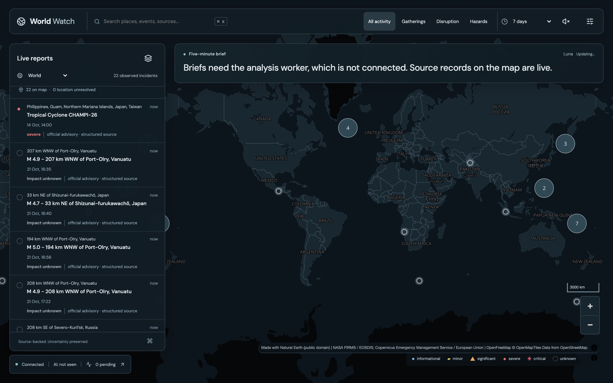
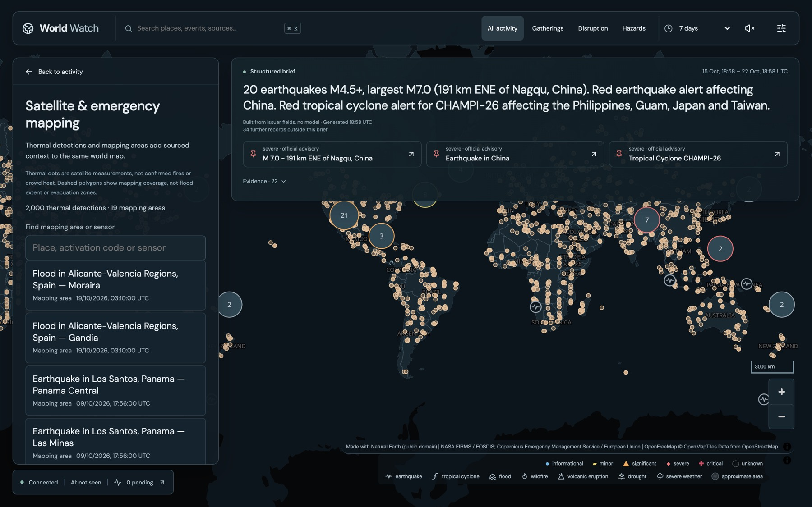
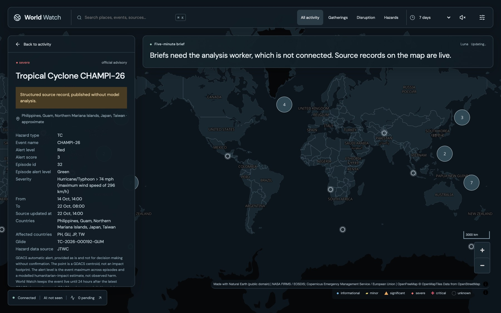
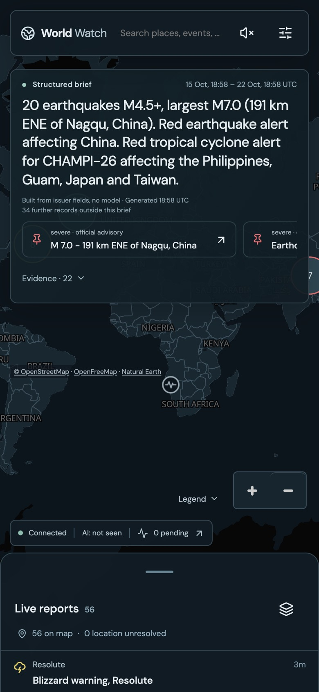
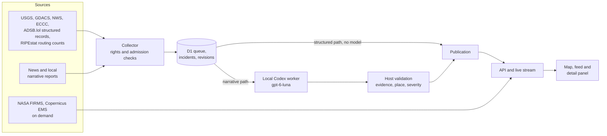

# World Watch



World Watch puts what's happening in the world on one flat map, and each marker links back to the public record behind it. Earthquakes from USGS, disaster alerts from GDACS, US storm and flood warnings from the National Weather Service, Canadian weather warnings from Environment and Climate Change Canada, aircraft emergency squawks heard by ADSB.lol's volunteer receivers, heat detections from three NASA satellites and Copernicus emergency mapping areas reach the map without a language model in the loop. So do national drops in Internet routing, which World Watch detects itself from the RIPE NCC's RIPEstat routing statistics. A separate news signal layer counts where GDELT's machine-geocoded news coverage of protests, strikes, conflict, displacement, evacuations and disasters is unusual for a place, links each signal to the original articles and never calls it an event. News and other narrative reports take a separate path, where a model extracts claims and the host checks each claim against the text it cites before anything is published.

It started as Europe Watch, a Europe-only prototype that wasn't useful enough. Routine notices crowded its feed. This version covers the world and is built as a hackathon showcase. The hosted deployment stays paused.

[Demo script](docs/DEMO.md) · [Product vision](docs/VISION.md) · [Backlog](TODO.md) · [Team handoff](docs/HANDOFF.md) · [Source atlas](research/world-atlas)

## Try it

You need Node.js 24 and npm.

```sh
npm ci
npm run demo
```

The demo starts a throwaway local server and database, pulls the live USGS, GDACS, NWS, ECCC and ADSB.lol feeds and the newest GDELT files, starts reading RIPEstat routing counts three countries at a time and opens a signed-in view at `http://127.0.0.1:4319/?hours=168`. It refreshes every five minutes. It makes its own random tokens and config in a temporary directory. It doesn't read your private files or call a model. Ctrl-C stops the demo's processes and deletes its data.

A public, read-only version of the same view can be published to GitHub Pages from a scheduled workflow, at no cost. It isn't switched on yet. [Public demo deployment](docs/DEPLOY-DEMO.md) has the commands, limits and terms.

On the evening of 22 October 2026 a run published 56 incidents. They included 21 earthquakes, among them an M7.0 quake 191 km east-northeast of Nagqu in China. GDACS issued a Red earthquake alert for China and a Red alert for Typhoon CHAMPI-26 affecting the Philippines, Guam, Japan and Taiwan. The other 34 were NWS and Environment Canada flood and storm warnings, including a blizzard warning for Resolute. The structured brief summed it up from issuer fields alone, and turning on the thermal layer loaded 196,952 detections from the last 24 hours across NOAA-20, NOAA-21 and Suomi NPP.







Screenshots show data from USGS (public domain), GDACS and the European Commission Joint Research Centre (CC BY 4.0), NASA FIRMS, the Copernicus Emergency Management Service and OpenFreeMap with OpenStreetMap contributors.

## How it works



The parts worth a closer look:

- A structured hazard publishes the moment the collector accepts it. Its impact comes from the issuer's own level. USGS PAGER and GDACS alert levels map to minor, significant and severe, and never to critical, because those levels are modelled loss estimates rather than reported harm. GDACS mixes archived events into its Orange and Red list (62 of 63 on 22 October), so only events it marks as current reach the map. An aircraft squawking 7700, 7600 or 7500 publishes as unverified, because the crew sets the code and nobody confirms it, and its impact stays at significant or below.
- One occurrence published by two issuers shows as one marker and one feed row, marked "2 sources", with both records in the detail panel. Earthquakes match on origin times within 30 seconds, epicentres within 25 km (wider above M6) and magnitudes within 0.5. Cyclones match on the storm name and season. A GDACS earthquake alert that names NEIC as its source republishes the USGS solution, so the row says "one origin" rather than counting it as independent corroboration. A near miss stays a "possibly the same event" note on two separate markers, and an operator can separate any pair without changing either record. A watch rule hears about a fused event once, unless a later record escalates it or changes materially.
- An Internet routing drop is World Watch's own measurement, not an issuer's alert. Each country's hourly count of visible IPv4 prefixes and networks is compared with the median of the week before, and a drop needs two consecutive hours with half the prefixes gone, or a quarter of them along with a tenth of the networks. Replayed over RIPEstat's history it found Egypt in 2011, Syria in 2012, Iran in 2019, Sudan in 2021 and the Iberian blackout in 2025 among 10 of 14 documented events, and missed shutdowns that filter traffic but leave routes up. It is labelled as a measured drop, never a confirmed shutdown or a cause.
- A model can't escalate a claim to severe or critical on its own say-so. The claim has to quote an affirmed consequence from its own cited evidence, such as "120 homes destroyed", or a matching official directive. Negated, hypothetical and drill wording is rejected within the same clause, using 22 lexicon tables that cover 23 languages. Chinese, Japanese and Thai, which don't put spaces between words, use substring matching. Anything the tables don't recognise fails closed. [An offline evaluation](docs/severity-evaluation.md) measures the gate on 1,908 Wikipedia excerpts about 264 earthquakes.
- When a source corrects or retracts an event, each watch rule that received the original alert gets the correction, even if the corrected location has left their watch area. A new alert fires only when a versioned projection of location, timing, instructions, severity or evidence changes. A reworded headline doesn't count.
- Geography works across the 180° line. Watch areas, map views and queries treat a box whose west edge is east of its east edge as crossing the dateline, so Fiji and the Aleutians resolve correctly. Place names come from a 34,174-place GeoNames gazetteer covering 244 country codes, with alternate names in local scripts.
- News signals come from GDELT's 15-minute knowledge graph files in English and in translation from 65 languages. A matched theme such as protest, curfew or refugees must sit within a sentence of a city GDELT geocoded, so a passing mention elsewhere in an article doesn't count. Mentions cluster by place, syndicated copies share one headline, and a place ranks by how far its last six hours sit above its own seven-day baseline. Only links, headlines and GDELT metadata are kept.
- The thermal layer reads the public 24-hour global files for three satellites and filters by the visible area on the server. When a view holds more than 2,000 detections, it takes the newest one from each cell of a 48 by 24 grid before taking second picks, so one busy region can't hide the rest. The panel says how many it is showing out of how many.
- Snapshot queries filter by area in SQL before their 1,000-row limit, so a quiet region still shows up beside a busy one. The project exhausted the free D1 read allowance once, and the read path is built around that lesson.
- The pipeline treats source text as evidence and ignores instructions inside it. The extraction worker runs without tools or file access, and a malicious-input evaluation recorded zero tool attempts.

The test suite has 362 tests, all offline, including intercepted browser runs. One opt-in test needs an authorised Codex host and is skipped by default.

## Honest status

The map, the structured hazard path and the satellite layers work live, as the demo shows. Several things don't yet.

- The five-minute model brief and narrative claims need the local Codex worker. Until a worker has connected, the brief panel shows a structured brief built only from issuer fields, such as GDACS alert levels, affected countries and USGS magnitudes. It is labelled as built without a model, and each statement cites the records it counts.
- The severity gate has been measured, narrowly. On 1,908 real excerpts in 23 languages, scored against USGS PAGER alert levels, it cuts an always-escalating proposer's false-escalation rate from 100% to 1.8% (95% CI 0.8 to 3.0). Against a keyword proposer it removes only 3.9 points (56.8% to 52.9%), mostly because PAGER models loss while the text reports real deaths. These are deterministic stand-ins, not a model, and cover earthquakes only. The method, licences and limits are in [the evaluation](docs/severity-evaluation.md); reproduce it with `npm run eval:severity`. Recall, relevance precision and a real model's severity accuracy haven't been measured.
- Most earthquakes show impact unknown, because USGS only issues PAGER alerts for damaging quakes.
- GDACS events and ADSB.lol squawk episodes stay live while their source lists them as current and end when it stops, which relies on the collector reading them. A stopped collector leaves the last current set on the map.
- ADSB.lol hears only aircraft near its volunteer receivers, so an emergency over most oceans and much of Africa and Asia never appears. Its public API is free but marked deprecated, and a resumed hosted deployment should contact ADSB.lol first and may need a feeder key.
- Only USGS, GDACS, ADSB.lol and the routing detector feed the map worldwide today. NWS and ECCC add polygon warnings for the United States and Canada, and the other enabled sources are European city and agency feeds.
- RIPEstat answers one country per request, so each country's routing is read about every five hours and a drop reaches the map four to nine hours after it starts. The RIPE NCC's terms for reusing RIS data ask for its logo, which needs its agreement first, so a public deployment should wait for that ([sources](docs/sources.md#internet-routing-drops)).
- News signals are GDELT's machine readings of coverage, with its geocoding, theme and translation errors. A place's baseline needs about 12 hours of collection, so a fresh demo ranks places by distinct headlines and marks nothing as rising. Signals don't reach the analysis worker, because publisher rights for model use of the linked articles aren't established. See [the method and its limits](docs/sources.md#worldwide-news-coverage-signals).
- No week-long endurance run, restore drill or production capacity measurement has been done. Read [the handoff](docs/HANDOFF.md) and [verification notes](docs/verification.md) before resuming anything.

## Source atlas

The worldwide research target is 50 useful sources per country. The atlas holds 43,211 distinct candidate hosts across 218 country codes, and 11,108 of them are news or curated specialist sources. At the discovery stage, 36 of the 195 target countries reach 50 candidates. None is yet verified as a working integration, and a catalogue entry is a lead rather than coverage. See [the atlas](research/world-atlas) for per-country numbers.

## Check a checkout

```sh
npm ci
npx playwright install chromium
npm run check
npm test
npm run build
npm run audit:public
```

Tests use disposable stores and fixtures, with temporary browser servers. They leave collection and inference stopped.

## Run an empty local app

`npm run demo` is the quickest route. To run the app against your own empty database instead, create an ignored `.dev.vars` with distinct random values.

```dotenv
EUROPE_WATCH_OWNER_TOKEN=replace-with-a-random-owner-secret
EUROPE_WATCH_COLLECTOR_TOKEN=replace-with-a-different-collector-secret
EUROPE_WATCH_WORKER_TOKEN=replace-with-a-different-worker-secret
```

```sh
chmod 600 .dev.vars
npm run migrate
npm run build
npm run dev -- --local --var STORAGE_PAUSED:0
```

Open `http://127.0.0.1:8787` and sign in with the owner token. Deployment identifiers such as these variable names keep the Europe Watch name so a resumed deployment finds its state.

[Worker setup](docs/codex.md) and [hosting configuration](deploy/README.md) need operator-owned credentials. Provider manifests under `.openai/` stay ignored.

## Pick up the work

Start with [AGENTS.md](AGENTS.md), then claim a bounded task from [TODO.md](TODO.md) and follow [CONTRIBUTING.md](CONTRIBUTING.md). [Architecture](docs/architecture.md) maps the implementation, and the [v2 contract proposal](docs/plans/PR1-v2-contracts.md) is the next planned change.

Application code is currently `UNLICENSED`, and public visibility grants no open-source licence. Dependencies and datasets keep their own terms, including [map and gazetteer attribution](docs/gazetteer.md).
