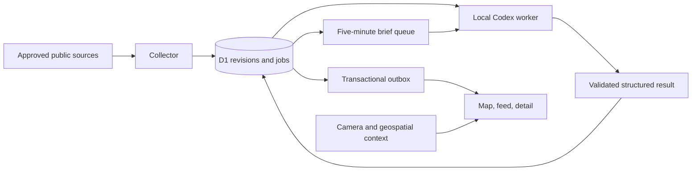

# Current architecture

This describes the paused prototype. Proposed replacements belong in [VISION.md](VISION.md) and [the backlog](../TODO.md).

## Modules

| Path                             | Responsibility                                                 | Current limit                                                                    |
| -------------------------------- | -------------------------------------------------------------- | -------------------------------------------------------------------------------- |
| `src/collector/registry.ts`      | Source policy and endpoints                                    | Registry entries do not establish useful coverage                                |
| `src/collector/index.ts`         | Bounded acquisition, admission and checkpoints                 | Source mix and achieved polling latency need evaluation                          |
| `src/collector/remote.ts`        | Pausable hosted dispatcher                                     | Empty schedules by default; requires operator configuration                      |
| `src/server/index.ts`            | HTTP API, authorization, persistence and publication           | Large coupled module; D1-specific SQL                                            |
| `src/server/bundling.ts`         | Conservative evidence grouping                                 | Exact content only; narrative cross-source identity is not matched               |
| `src/server/fusion.ts`           | Deterministic same-event links between structured records      | Earthquakes and named cyclones only; tolerances not yet evaluated                |
| `src/server/geo.ts`              | Gazetteer-backed place resolution                              | Place centroids and uncertainty, not street-level verification                   |
| `src/server/brief.ts`            | Brief window claims and completion                             | Obsolete bootstrap-window scheduling bug remains                                 |
| `src/server/news.ts`             | GDELT news signal storage, baseline and ranking                | Machine-geocoded coverage counts, not events; baseline needs hours of collection |
| `src/server/structured-brief.ts` | Model-free headline from issuer fields until a worker connects | English only                                                                     |
| `src/server/feeds.ts`            | Atom and GeoJSON renderings of notices and snapshot records    | English only; entries carry no record summary                                    |
| `src/server/push.ts`             | VAPID signing and aes128gcm encryption for Web Push            | Not yet sent through a real browser push service                                 |
| `src/worker/worker.ts`           | Claims, renewals, analysis and result submission               | Runs only when its host, auth and quota are available                            |
| `src/worker/adapter.ts`          | Local supported Codex transport and isolation checks           | Exact requested model is known; effective model/tier is not attested             |
| `src/client/App.tsx`             | Feed, selection and contextual tools                           | Large component; workflow and relevance need redesign                            |
| `src/client/Map.tsx`             | Flat MapLibre map                                              | Sparse source geography and uncertain locations limit value                      |
| `src/sites-entry.ts`             | Optional private Sites hosting wrapper                         | Provider-specific identity and migration wiring                                  |
| `deploy/migrations`, `drizzle`   | Cloudflare and Sites schema paths                              | Equivalent schema evolution needs continued testing                              |

The backend uses D1. PostgreSQL/PostGIS, a separate Redis queue and an always-on inference host are not implemented. The prototype's original free database exhausted its read allowance. Moving the private deployment to another managed binding did not prove sustained capacity or free continuous operation.

## State and failure boundaries

A source-native report ID and substantive revision identify ingestion work. Jobs use leases, attempt IDs and fences; result submission checks that the claim is still valid. Completed local results are spooled durably before submission and removed after acceptance. Delivery is at least once: a crash before durable spooling can repeat an inference call.

Claims, incident revisions and outbox records support replay and publication. Publication time, source-update time, ingestion time and asserted event time have different meanings. Missing event times and locations must stay unresolved. Multiple reports from the same upstream origin do not establish independent corroboration.

Replay answers "what did the platform know at T?", never "what happened at T?". A revision is held from its `known_at` until `superseded_at`, the time the next higher version became known, which a trigger maintains on insert (migration 0014). `GET /api/snapshot?at=T` reads the revisions held at T: without a bbox through the knowledge-time index, stopping at 1,000, and with one through `revisions_cell` (cell, window key, known_at) for window keys up to three days past T, plus `revisions_lasting`, a partial index of revisions whose window key lies more than three days past their own knowledge time, for long-lived and issuer-current ones. Window, area and text are judged on the held view, and the same eligibility and view filters as live apply. Rights are today's. `/api/incidents/{id}?at=T` returns the held revision with only the history, shared evidence and origins known by T, and `/api/brief?at=T` the newest model brief completed by T, checked against the revisions held then, or a structured brief built from them without news signals. Source health, news signals, satellite layers, cameras and the GNSS interference grid keep no history. Aviation advisories (ash SIGMETs, EASA bulletins) are incidents, so they replay like any other.

Structured records of one occurrence from different issuers stay separate incidents. When a record publishes, `fusion.ts` reads candidates through the latitude index and an origin-time window (earthquakes) or the search index by storm name and season (cyclones), and writes the verdict into the optional `links` field of both incidents as a new revision. `same_event` joins them into one marker, feed row and brief statement with every record in the detail panel. Its `independence` is `same_origin` when one record republishes the other's measurement (GDACS naming NEIC for a USGS quake) and `independent` only when both name different origins. Evidence short of the rule's tolerances stays `possible_same_event` and never fuses. An operator `split_from` decision separates a pair and no rule overrides it; `POST /api/incidents/link` records it or hands the pair back to the rule, leaving both records otherwise unchanged. These map to the plan's `same_origin`, `supports`, `possible_same_event` and `split_from` relationships. A view without `links` reads as before.

Watch rules are evaluated per record on every published revision, and a fused situation notifies a rule once. A record that has never notified a rule, whose `same_event` partner has, is suppressed as `same_situation_notified` unless it escalates past the severity the partner notified, or its own `alert-material-v1` projection has changed since it was last suppressed that way. Corrections and retractions keep following each record's own prior notices.

Eligible notices leave the app through two channels in `src/server/feeds.ts` and `src/server/push.ts`, with no provider account. `GET /api/alert-rules/{id}/feed.atom` and `.geojson` list a rule's latest eligible notice per incident, as the revision it was given for, newest first and at most 100. The entry ID is the incident's and `updated` is the notice time, so only a material change or a correction moves an entry; a correction says so in its title and a `correction` category. A feed reader can't sign in, so the URL carries an HMAC of the rule ID under the owner token, and rotating that token revokes every feed link. Feeds follow current rights like exports: a record any of whose sources lacks `redistribute` is left out and counted in the subtitle. For Web Push the batch that inserts an eligible notice also inserts one `push_outbox` row per owner device, and only when the notice is new in that batch. A correction's rows go only to devices subscribed by the last earlier notice. After the batch, the request sends each row as an RFC 8291 aes128gcm message signed with RFC 8292 VAPID keys from the environment, carrying the headline, impact, place and incident link and nothing else. A device whose push service answers 404 or 410 is removed, other failures stay queued for the next dispatch or the scheduled run, and rows older than the six-hour TTL are dropped. Without all three VAPID variables nothing is queued. The public demo builds its own static feeds from the snapshot, described in [DEPLOY-DEMO.md](DEPLOY-DEMO.md#feeds).

Owner, collector and worker application credentials have separate scopes. Optional private Sites service access is an additional credential boundary. Codex authentication stays on its inference host. Source content is untrusted input and must not choose commands, credentials, tools or fetch destinations.

Schema and quotation validation catch some bad model output. They do not establish the truth of a report, calibrated severity, accurate clustering or useful prioritisation. Those require labelled evaluation and operator review.

Camera and satellite context do not enter the inference queue by default. Thermal detections are observations rather than confirmed incidents; camera availability does not establish live capture time or measured crowd activity.

See [HANDOFF.md](HANDOFF.md) for entry points and [verification.md](verification.md) for evidence limits.
