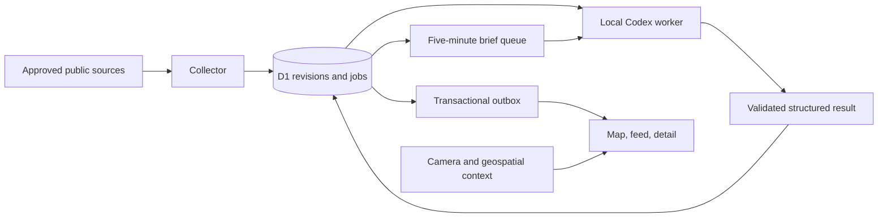

# Current architecture

This describes the paused prototype. Proposed replacements belong in [VISION.md](VISION.md) and [the backlog](../TODO.md).

## Modules

| Path                           | Responsibility                                       | Current limit                                                        |
| ------------------------------ | ---------------------------------------------------- | -------------------------------------------------------------------- |
| `src/collector/registry.ts`    | Source policy and endpoints                          | Registry entries do not establish useful coverage                    |
| `src/collector/index.ts`       | Bounded acquisition, admission and checkpoints       | Source mix and achieved polling latency need evaluation              |
| `src/collector/remote.ts`      | Pausable hosted dispatcher                           | Empty schedules by default; requires operator configuration          |
| `src/server/index.ts`          | HTTP API, authorization, persistence and publication | Large coupled module; D1-specific SQL                                |
| `src/server/bundling.ts`       | Conservative evidence grouping                       | Similarity and cross-source event identity are incomplete            |
| `src/server/geo.ts`            | Gazetteer-backed place resolution                    | Place centroids and uncertainty, not street-level verification       |
| `src/server/brief.ts`          | Brief window claims and completion                   | Obsolete bootstrap-window scheduling bug remains                     |
| `src/worker/worker.ts`         | Claims, renewals, analysis and result submission     | Runs only when its host, auth and quota are available                |
| `src/worker/adapter.ts`        | Local supported Codex transport and isolation checks | Exact requested model is known; effective model/tier is not attested |
| `src/client/App.tsx`           | Feed, selection and contextual tools                 | Large component; workflow and relevance need redesign                |
| `src/client/Map.tsx`           | Flat MapLibre map                                    | Sparse source geography and uncertain locations limit value          |
| `src/sites-entry.ts`           | Optional private Sites hosting wrapper               | Provider-specific identity and migration wiring                      |
| `deploy/migrations`, `drizzle` | Cloudflare and Sites schema paths                    | Equivalent schema evolution needs continued testing                  |

The backend uses D1. PostgreSQL/PostGIS, a separate Redis queue and an always-on inference host are not implemented. The prototype's original free database exhausted its read allowance. Moving the private deployment to another managed binding did not prove sustained capacity or free continuous operation.

## State and failure boundaries

A source-native report ID and substantive revision identify ingestion work. Jobs use leases, attempt IDs and fences; result submission checks that the claim is still valid. Completed local results are spooled durably before submission and removed after acceptance. Delivery is at least once: a crash before durable spooling can repeat an inference call.

Claims, incident revisions and outbox records support replay and publication. Publication time, source-update time, ingestion time and asserted event time have different meanings. Missing event times and locations must stay unresolved. Multiple reports from the same upstream origin do not establish independent corroboration.

Owner, collector and worker application credentials have separate scopes. Optional private Sites service access is an additional credential boundary. Codex authentication stays on its inference host. Source content is untrusted input and must not choose commands, credentials, tools or fetch destinations.

Schema and quotation validation catch some bad model output. They do not establish the truth of a report, calibrated severity, accurate clustering or useful prioritisation. Those require labelled evaluation and operator review.

Camera and satellite context do not enter the inference queue by default. Thermal detections are observations rather than confirmed incidents; camera availability does not establish live capture time or measured crowd activity.

See [HANDOFF.md](HANDOFF.md) for entry points and [verification.md](verification.md) for evidence limits.
